<div align="center">

<picture>
  <source media="(prefers-color-scheme: dark)" srcset="docs/logo-dark.png" />
  
</picture>

# JeeA!

**Many AIs. One place.**

Chat with many AI models in one beautiful app. Start free with no key, add your own API keys, compare models side by side, give different models different jobs, build web apps live, and run AI agents, in your browser or 24/7 on GitHub.

**Live site:** https://jeewan0406.github.io/JeeAI-by-Jeewan/ *(works after GitHub Pages is switched on, see [Deploy](#deploy-on-github-pages))*

**Repository:** https://github.com/Jeewan0406/JeeAI-by-Jeewan (renamed from `Computervision` on 25 November 2026; please update bookmarks and links to the new addresses)

**Anyone can register and use it**, once the owner has run the one-time set-up in [Make it a public website](#make-it-a-public-website).

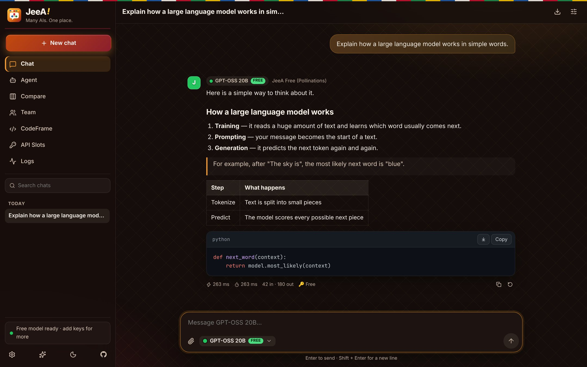

</div>

---

## What you can do

| Feature | What it does |
|---|---|
| ✨ **Auto model** | Choose **Auto** and JeeA! picks a model for each question: small fast free models for simple questions, the strongest model you can use for demanding ones (analysis, proofs, code, long files), and only picture-reading models for pictures. Each answer says which model replied and why. |
| 🔁 **Automatic switching** | If a model is busy, refuses, sends an empty answer, does not reply in time or stops halfway, JeeA! switches to another good model by itself (from another service first) and starts the answer again. |
| 📎 **Files and pictures** | Attach or drop **PDF, Word, PowerPoint, Excel**, text and code files: JeeA! reads them in your browser and sends their text (slides with speaker notes, every Excel sheet). Paste a **screenshot** or attach a **picture** in Chat and Compare; it goes to models that can see images. Text copied from Word, PowerPoint or a web page pastes as text. |
| 🧠 **Thinking levels** | Low, Medium, High, Extra high and Max in every message box. Higher levels give every model critical-thinking steps (split the problem, question assumptions, check every number, give counter-arguments, compare options and sources). Claude and OpenAI reasoning models also get their real effort setting. At **Max**, Chat makes the model review its first answer as a strict expert and rewrite it. |
| 💬 **Chat** | A standard chat with the model picker inside the chat box and friendly model names ("Llama 3.3 70B", "Gemini 2.5 Flash"): streaming answers, Markdown, tables, code highlighting, the model's reasoning (when it shares it), edit and resend, regenerate, history with search, pin and rename, export to Markdown. |
| 🌐 **Trusted sources for every question** | Before every question in Chat, Compare, Team and Agent, JeeA! searches **trusted sources only**: recent research (OpenAlex), news and releases from the UN, governments and space agencies, new papers from leading journals, established news organisations (collected every hour by this site's GitHub job), and web search limited to trusted sites if the site owner adds a key. No Wikipedia, blogs or social media. Each source comes with a ready **APA 7th** citation. The 🌐 button switches between **On** (default), **Auto** and **Off**. |
| 📄 **Export** | Save any answer, or a whole chat, as a **Word** document, **PDF**, **Excel** workbook (tables, text, sources), **PowerPoint** slides, Markdown, or an image (PNG, JPG, SVG). |
| 🖼️ **Images** | Make pictures from a description: free with a Puter account, free for visitors through the JeeA Gateway (FLUX on Cloudflare), or with your own OpenAI key. Download as PNG, JPG or WebP. |
| ✎ **Custom instructions** | One box, up to **50,000 characters**, written once and sent to every conversation in Chat, Compare, Team, Agent and CodeFrame; each area can be switched off. |
| ✅ **Answer standard** | Every model follows JeeA!'s standard: length that fits the question, only trusted and recent sources, **two or more sources per key claim**, facts and figures with dates and units, **APA 7th** citations and a reference list. |
| 📁 **Projects** | At the top of the left panel. Keep related conversations together with shared instructions and files (text, code, PDF with page numbers, Word). Large files are searched, and only the passages related to each question are sent, with file and page. |
| 📜 **Answer rules** | The site owner's answer rules (plain English, checked and cited sources, honesty, Checks lines, evidence judging) go to every model as system text, with a short note on how they work inside JeeA!. Edit, reset or switch them off in **Settings → Answer rules**. |
| ➗ **Maths** | LaTeX formulas, boxed results and coloured citations display properly (KaTeX, loaded only when a message needs it). |
| 🤖 **Agent** | Give a goal. The agent searches trusted sources first, then plans and uses tools step by step: web pages, exact maths, a JavaScript sandbox, date and time, long-term memory, workspace files, creating web apps, and asking other models. Every step is shown and can be opened. |
| ⏰ **24/7 agents** | Scheduled agents run on GitHub Actions in your repository, even when your computer is off, and save Markdown reports that the Agent page shows. |
| 🆓 **Free models** | Works the moment the page opens: the shared Pollinations model and **OVHcloud** (Llama 3.3 70B, gpt-oss 120B, Qwen, DeepSeek and more) need no sign-up and no key; **AI Horde** (volunteers, slow) too. **In your browser**: WebLLM runs open models on your own graphics chip, and Chrome's built-in Gemini Nano is used where Chrome offers it — no server at all. **Puter** adds hundreds of models (GPT, Claude, Gemini, Llama…) with a free Puter account. With the optional **JeeA Gateway**, the site owner can share free NVIDIA and other models with every visitor. Free models carry a green **Free** tag. |
| 🔑 **API Slots** | Add as many keys as you like for 19 providers, or your own endpoint. Several keys for one provider are rotated, and a key that hits a rate limit is rested while the next one takes over. |
| ⚖️ **Compare** | Send one prompt to up to 6 models at once. See time to first token, total time, speed and tokens. Vote for the best answer, keep a personal leaderboard, or let an AI judge rank the anonymous answers. |
| 👥 **Team** | Give different models different roles in one run. Three ways to work: **Pipeline** (one after another), **Mixture** (all answer, one merges) and **Debate** (argue in rounds, a judge decides). Five ready-made teams. |
| 🧩 **CodeFrame** | Describe an app and watch the code being written, then run it in a locked sandbox. Editor, phone/tablet/desktop sizes, console with "ask the AI to fix these errors", version history, download. |
| 📈 **Logs** | Every request is recorded: provider, model, key name, status, time to first token, total time and tokens. Charts, filters and CSV/JSON export. No keys or message text are stored in the log. |
| 🎨 **Design** | The JeeA! logo (a head whose brain is a network of linked nodes) in the theme's colour, and a Bhutan-inspired "Druk" look: saffron, gold and maroon, a dzong-white light mode, a prayer-flag ribbon and a faint woven-textile pattern. Dark and light themes, 6 accent colours, works on phones, installable as an app (PWA), works offline after the first visit. |

<table>
<tr>
<td>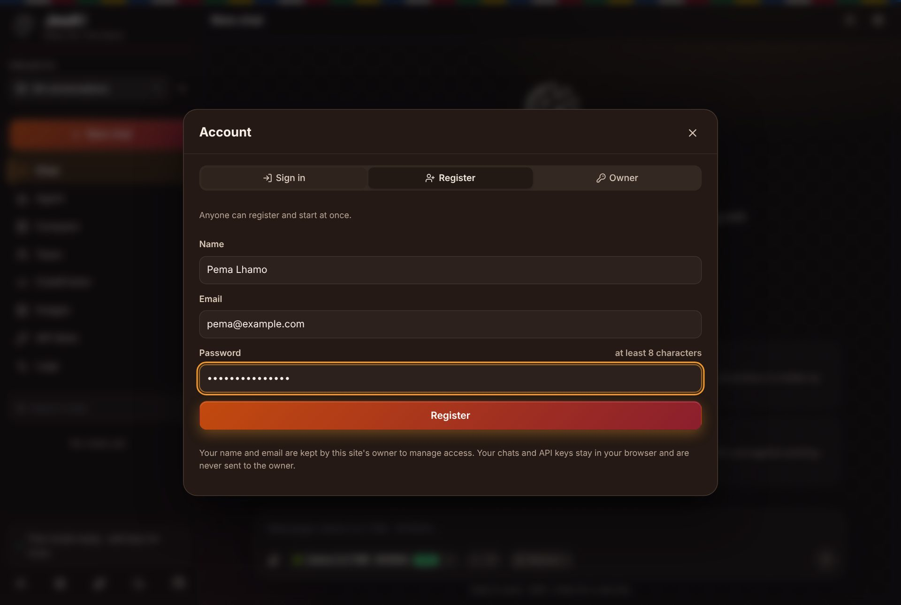</td>
<td>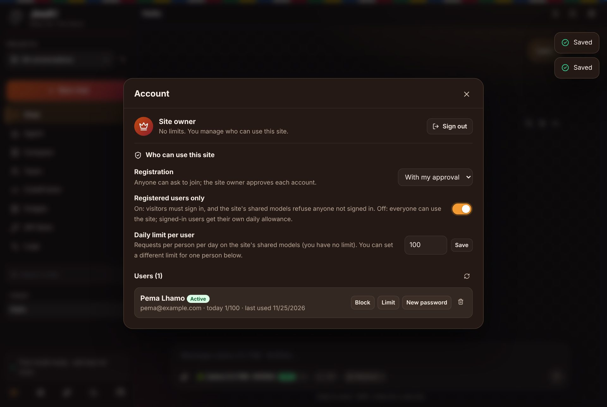</td>
</tr>
<tr>
<td>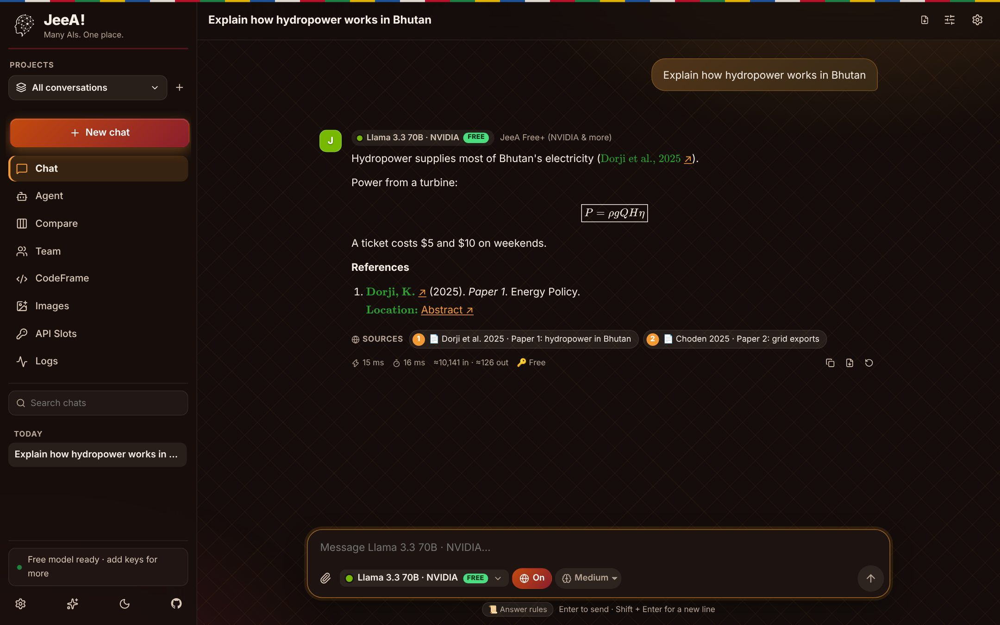</td>
<td>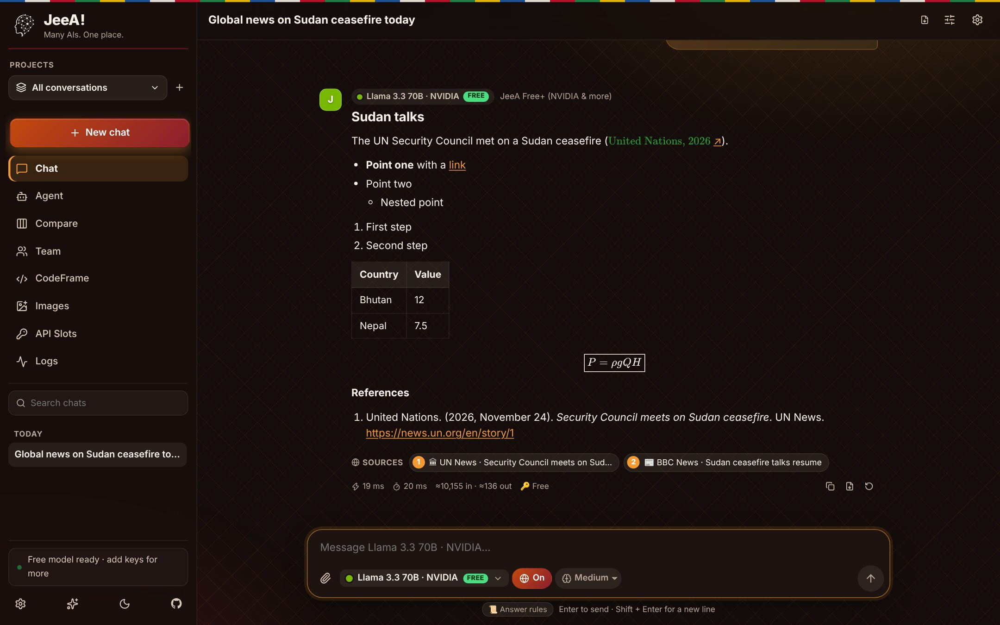</td>
</tr>
<tr>
<td>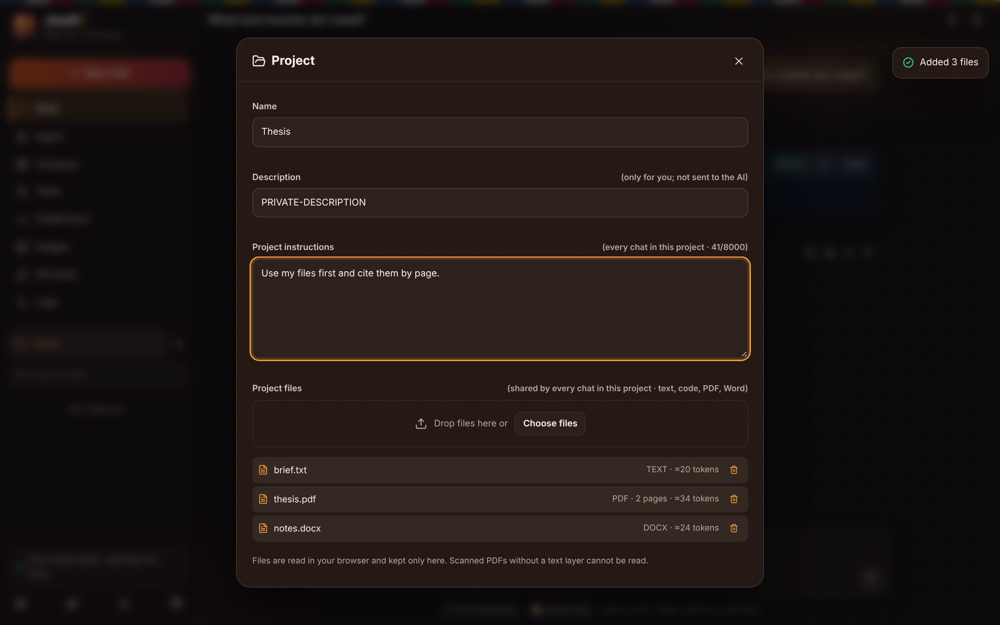</td>
<td>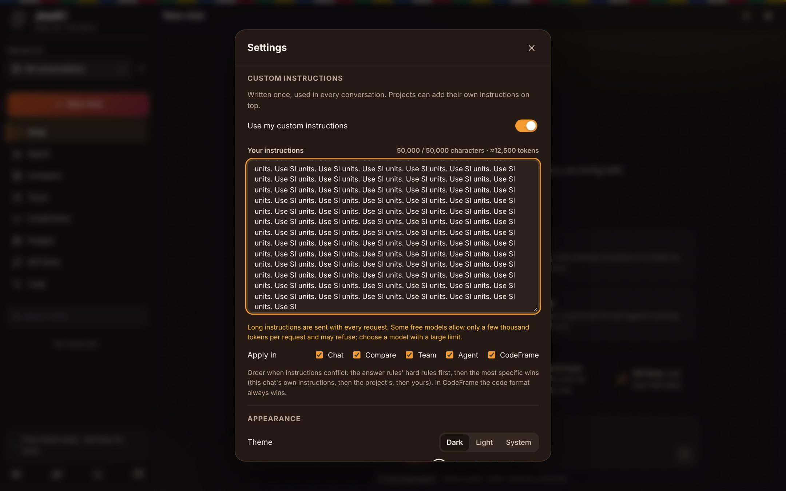</td>
</tr>
<tr>
<td>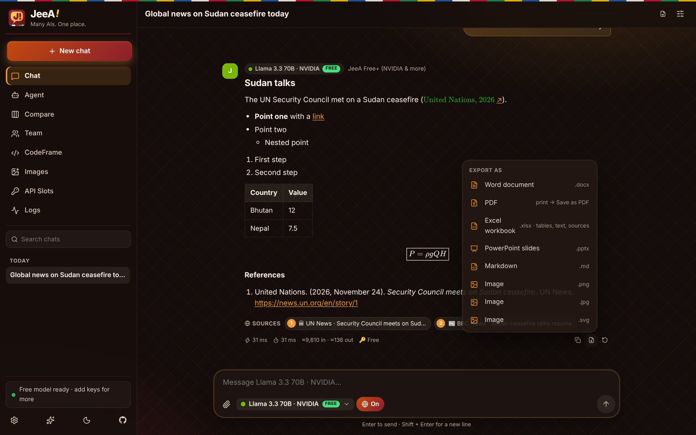</td>
<td>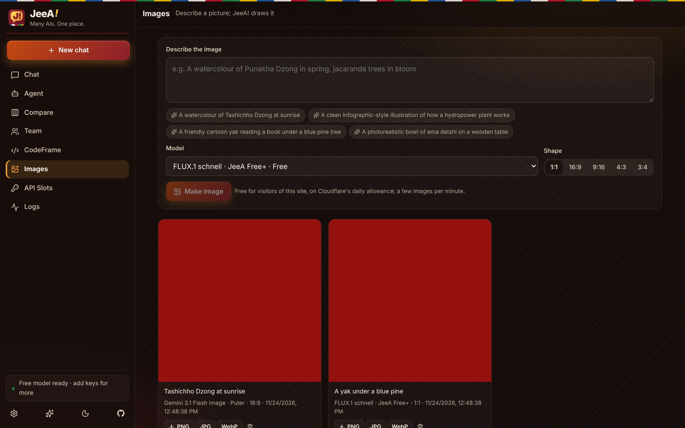</td>
</tr>
<tr>
<td>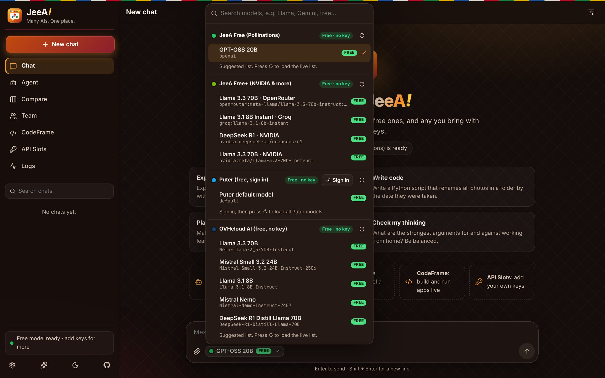</td>
<td>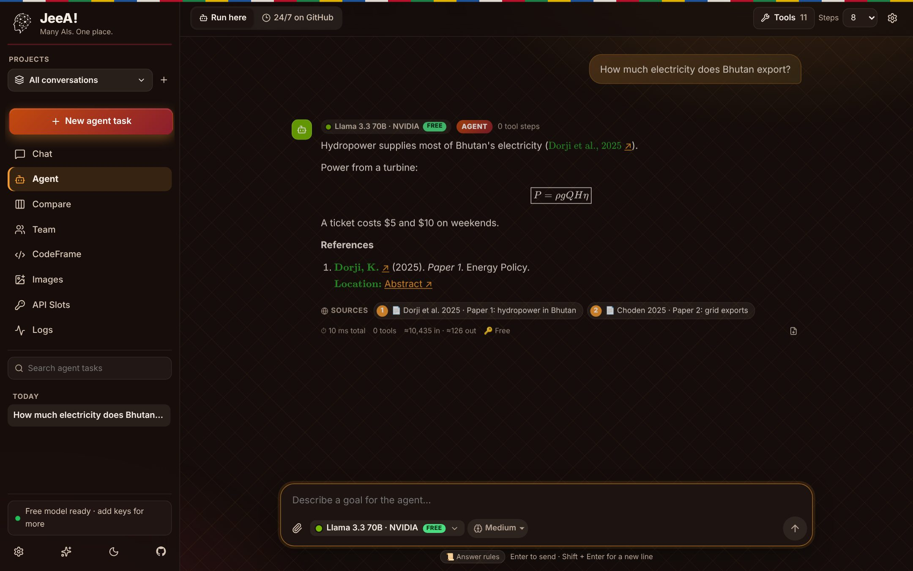</td>
</tr>
<tr>
<td>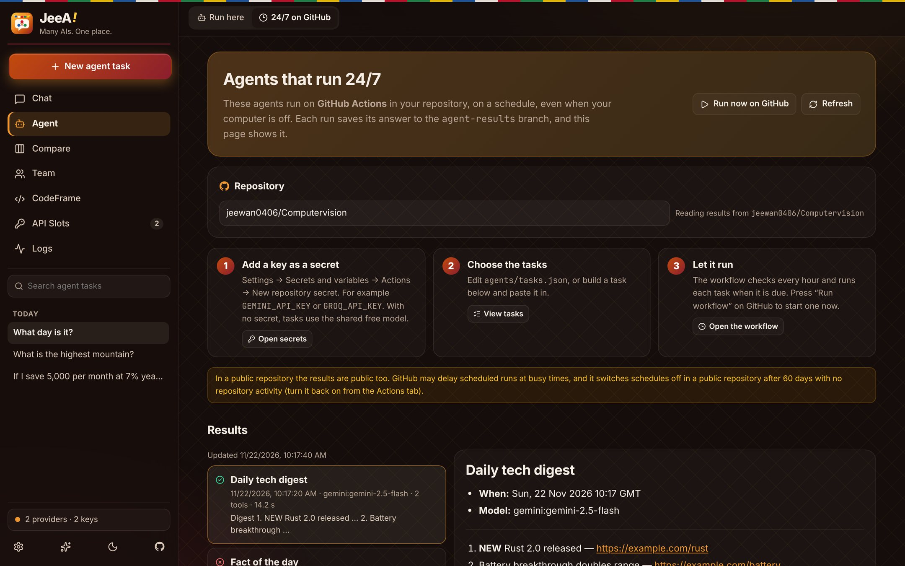</td>
<td align="center">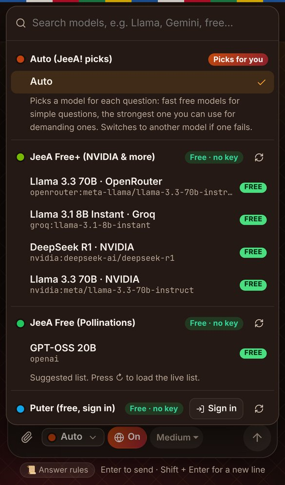</td>
</tr>
<tr>
<td></td>
<td>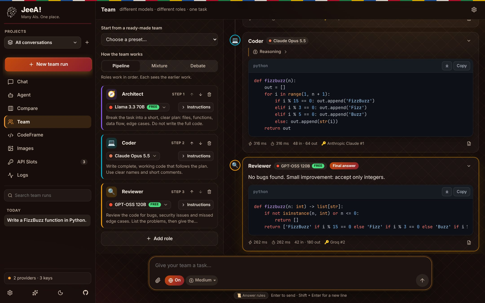</td>
</tr>
<tr>
<td>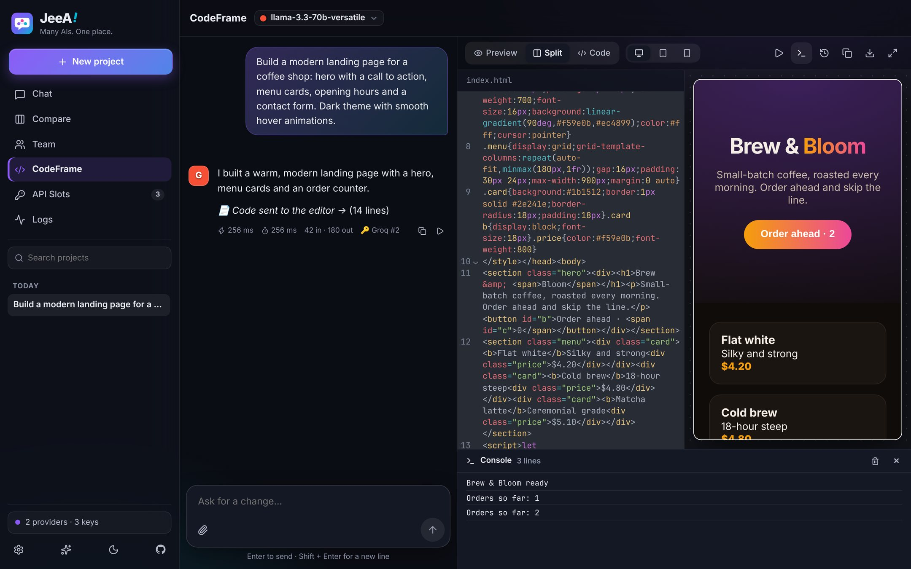</td>
<td>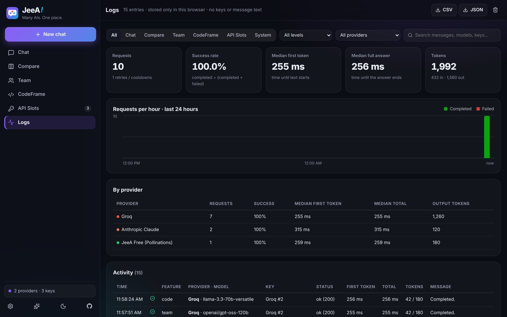</td>
</tr>
<tr>
<td></td>
<td></td>
</tr>
</table>

## Providers

You can use any model a provider offers: JeeA! loads the live model list from the provider once you add a key, and you can also type any model id by hand.

| Provider | Access | Notes |
|---|---|---|
| JeeA Free (Pollinations Classic) | Free, no key | One text model, one request per IP at a time, at least 45 seconds apart ([Pollinations docs](https://github.com/pollinations/pollinations/blob/master/APIDOCS.md)). Good for trying the app. |
| OVHcloud AI Endpoints | Free, no key | Anonymous use: 2 requests per minute per IP and per model (OVHcloud's limit). 33 models on 2026-11-24, including Llama 3.3 70B, gpt-oss 120B/20B, Qwen3.5 397B, DeepSeek V4.1 Flash, Mistral Small 3.2, Gemma 4 and two Qwen VL models that can see pictures. |
| AI Horde | Free, no key | A volunteer network (`oai.aihorde.net`, anonymous key). It works from the browser but answers took about 50 seconds in our check, volunteers could see prompts (never send private data), and unfiltered community models are hidden. |
| In your browser (WebLLM) | Free, runs on your device | Open models (Llama 3.2, Qwen3, Phi-4 mini, Gemma…) run on your graphics chip through WebGPU, in a background worker ([WebLLM](https://github.com/mlc-ai/web-llm)). Needs a recent Chrome or Edge on a computer; the first use downloads the model (about 0.7–5 GB), then it works offline. Small models see about 4,000 tokens, so they get a short version of the instructions and fewer web results. |
| Chrome built-in AI (Gemini Nano) | Free, runs on your device | Used only where Chrome offers its built-in Prompt API (`LanguageModel`) on a supported computer. JeeA! checks this when you send and explains if it cannot run (Chromium has the interface but no model). |
| Puter | Free, no key in JeeA! | Each person signs in with a free Puter account; usage counts against their own Puter allowance ("user pays"). Puter.js is bundled at a pinned version and loads only when chosen. |
| JeeA Free+ (your gateway) | Free for visitors | Appears when `public/jeea.config.json` names your gateway. It uses **your** free keys (NVIDIA and others), so every visitor shares their limits. See below. |
| Google Gemini · Groq · OpenRouter (":free" models) · Mistral · Cerebras · Ollama Cloud · Z.ai (GLM flash models) · SiliconFlow (some models) · Hugging Face · Cohere · SambaNova · NVIDIA NIM | Free tier with a key | Free tiers and their limits are set by each provider and change often. Check the provider's page. NVIDIA may block direct browser calls; use the CORS proxy or the gateway. |
| OpenAI · Anthropic Claude · DeepSeek · xAI Grok · Together AI | Paid key | |
| Ollama · LM Studio | Runs on your computer | Turn on CORS in the local server (see the note in the app). |
| Your own endpoint | Any | Any OpenAI-compatible `/chat/completions` server, or the Anthropic Messages format. |

## Make it a public website

JeeA! is already on the public web: anyone who finds the address can open it. To let **anyone register and use it** (with you, the owner, in charge), run the one-time set-up below. One button in GitHub does the technical part: it creates the accounts database and the JeeA Gateway on your free Cloudflare account, connects the site to it and republishes the site.

**One-time set-up (about 10 minutes; Cloudflare's menu names may differ slightly):**
1. **Cloudflare account.** Sign up free at cloudflare.com. Open **Workers & Pages** once and choose your *workers.dev* subdomain (Cloudflare needs it before the first deploy).
2. **API token.** In Cloudflare: **My Profile → API Tokens → Create Token** → template **"Edit Cloudflare Workers"**, and add the permission **Account → D1 → Edit** (and **Workers AI** if offered, for the free Cloudflare models). Copy the token.
3. **Account ID (optional).** The set-up finds it from the token by itself. You only need it if your token can reach more than one Cloudflare account: then copy it from the Cloudflare dashboard (Workers & Pages → Account details, or the long code after `dash.cloudflare.com/` in the address bar).
4. **GitHub secrets.** In this repository: **Settings → Secrets and variables → Actions → New repository secret**, add:
   - `CLOUDFLARE_API_TOKEN` — the token from step 2,
   - `JEEA_OWNER_KEY` — your own long passphrase for signing in as the owner,
   - `CLOUDFLARE_ACCOUNT_ID` — only if you need it (step 3).
   Optional: `NVIDIA_API_KEY`, `GROQ_API_KEY`, `GEMINI_API_KEY`, `OPENROUTER_API_KEY`, `TAVILY_API_KEY` (more shared models and web search). Never paste these into an issue or a chat.
5. **Run it.** **Actions → "Set up accounts and free models" → Run workflow.** Choose whether visitors must register first (default yes), who can register (default open) and the daily limit (default 100). About two minutes later the site has a **👤 Account** button and a **Create a free account** button on the home screen.
6. **Sign in as the owner:** **Account → Owner →** your `JEEA_OWNER_KEY`.

Run the workflow again any time (for example after adding a provider key): people stay signed in.

**Help people find it:**
- **GitHub page:** on the repository's main page, click ⚙ next to **About**, set **Website** to `https://jeewan0406.github.io/JeeAI-by-Jeewan/`, add a description and topics (for example `ai`, `chatbot`, `llm`). Under **Settings → General → Social preview**, upload `docs/social-preview.png`.
- **Google:** add the site in Google Search Console (URL-prefix property `https://jeewan0406.github.io/JeeAI-by-Jeewan/`), verify it with the HTML-tag method, and submit `sitemap.xml`. The verification tag is not secret, so it can be added to `index.html`.
- The page already has a title, description, social card (`og-image.png`), structured data and a sitemap. A `robots.txt` would have no effect here, because search engines read it only at the top of `jeewan0406.github.io`, which is a different repository.
- **Your own address (optional, paid):** buy a domain (for example `jeeai.app`), add it under **Settings → Pages → Custom domain**, and add the DNS records GitHub shows. Run the set-up workflow again afterwards so the gateway accepts the new address.

## Accounts: let the public register (you stay the owner)

Anyone can open JeeA! and use it with their own keys or the free no-key services; that costs you nothing. What costs **you** is the **JeeA Gateway**: the free models you share with your own keys and allowances. Accounts control who may use those.

**For the public:** open **👤 Account** (bottom left) → **Register** with name, email and password → use the site's shared models within a daily allowance. Passwords are stored only as salted PBKDF2-SHA-256 hashes; sign-ins expire after 30 days.

**For you, the owner:** **👤 Account → Owner** → enter your owner key. You have **no limits** and an admin panel:
- **Registration:** *Open* (anyone joins at once), *With my approval* (you approve each person) or *Closed*.
- **Registered users only:** when on, visitors see a sign-in screen and the gateway refuses anyone not signed in. When off, everyone can use the site; signed-in users get their own daily allowance.
- **Daily limit per user** (default 100 requests), and per person: approve, block (signs them out everywhere at once), unblock, own limit, set a new password, delete.

**Set-up:** the easy way is the GitHub button in [Make it a public website](#make-it-a-public-website). By hand instead (Cloudflare dashboard; menu names may differ slightly):
1. Deploy the JeeA Gateway (steps in the next section) and put its address in `public/jeea.config.json`.
2. Create a **D1 database** (Storage & Databases → D1), then in the Worker's **Settings → Bindings** add it as a D1 binding named **`DB`**. The Worker creates its tables itself.
3. In **Settings → Variables and Secrets** add two **secrets**: **`AUTH_SECRET`** (a long random text; it signs sign-ins) and **`OWNER_KEY`** (your own long passphrase). Never put them in the repository or share them in a chat.
4. Optional text variables: `SIGNUP_MODE` (`open`, `approval`, `closed`), `REQUIRE_ACCOUNT` (`on`), `DAILY_LIMIT` (number). You can change all three later in the app.
5. Paste the latest `proxy/jeea-gateway.js` into the Worker and deploy. Then sign in on the site with **Account → Owner**.

**What is enforced, and what is not.** The gateway checks every request on the server, so blocked, unapproved or signed-out people cannot use your shared models. The sign-in screen in the app is only a front door: the app's code is public, so a technical person could run their own copy. That copy can use only their own keys and public free services, never your gateway.

**Privacy and limits.** You can see registered names, emails, daily use and last use. Chats and API keys stay in each person's browser and are never sent to you. There is no email check and no "forgot password" email (the site has no mail service); you can set a new password for someone. Sign-up and sign-in attempts are limited per visitor per minute.

## Auto and automatic switching

**Auto** is the first entry in the model picker (and the default for new visitors). For each question it:

1. **Scores the question** as simple, standard or complex from plain signals: length, code, maths and proofs, reasoning words (compare, evaluate, recommend, trade-offs…), several parts, attached files, pictures, and the thinking level (Low lowers it, High to Max raise it).
2. **Ranks the models you can use** (free no-key services, the gateway, and every provider you added a key for). Each model gets a rough strength from 1 to 5 from its name: its family (for example Claude Opus, GPT-5, Gemini Pro are 5) or its size ("70B" is 4, "8B" is 2). Free models, your own keys and your Compare votes add points; slow shared free tiers, models still waiting for their next free slot and models that failed recently lose points. Simple questions go to small fast models, demanding ones to the strongest.
3. **Shows why**: every answer says, for example, *"Auto: a demanding question (reasoning, maths), so it chose the strongest model available."*

The strength estimate is a rule of thumb from model names, not a benchmark. If you prefer one model, pick it directly.

**Automatic switching** works for any model, Auto or not. When a model is busy, refuses, cannot be found, sends an empty answer, gives no first word in time (75 s; 180 s at Extra high and Max) or stops halfway, JeeA! moves on: first to your own backup models, then to up to four models chosen the way Auto chooses, from other services first (one service being down often affects all its models). A half-written answer is cleared and started again. The answer shows *"switched from … (reason)"*, and the Logs page records each step. Agent runs keep one model for the whole task, because their tool history belongs to that model. Settings: **API Slots → Routing & reliability**.

## Free models for every visitor: the JeeA Gateway

No AI provider offers truly unlimited free use, and an API key placed in a public website can be copied by anyone. The JeeA Gateway solves the second problem: it is a small Cloudflare Worker (`proxy/jeea-gateway.js`) that keeps **your** free keys secret and lets only your site use them, with a per-visitor limit (default 12 requests per minute).

1. Create a free Cloudflare account. In the dashboard, open **Workers & Pages → Create application**, pick the **Hello World** Worker template, name it `jeea-gateway`, and **Deploy**.
2. Open the Worker, choose **Edit code**, replace everything with the contents of `proxy/jeea-gateway.js`, and **Deploy**.
3. Open **Settings → Variables and Secrets → Add**. Add `NVIDIA_API_KEY` with type **Secret** (your key from build.nvidia.com). Optionally add `GROQ_API_KEY`, `GEMINI_API_KEY`, `CEREBRAS_API_KEY`, `MISTRAL_API_KEY`, `OPENROUTER_API_KEY` as secrets, and `ALLOWED_ORIGINS` (type Text) = `https://<your-user>.github.io`. **Deploy**.
4. *(Free, no extra key)* In the Worker's **Settings**, look for **Bindings** and add a **Workers AI** binding named `AI` (the dashboard wording may differ slightly; with Wrangler it is `"ai": { "binding": "AI" }` in the config file). This adds Cloudflare Workers AI models (Llama 3.3 70B, Llama 4 Scout, Mistral Small 3.1, QwQ 32B, DeepSeek R1 Distill, Qwen 2.5 Coder, GPT-OSS 120B), which use Cloudflare's free allowance of 10,000 Neurons per day ([Cloudflare pricing docs](https://github.com/cloudflare/cloudflare-docs/blob/production/src/content/docs/workers-ai/platform/pricing.mdx)).
5. *(Optional, full web search)* Add the secret `TAVILY_API_KEY` (a key from tavily.com). JeeA!'s search then also uses web search through `POST /v1/search`, **limited to trusted sites** (the `TRUSTED_DOMAINS` list in the Worker, plus government, university and intergovernmental addresses), cached for 10 minutes and limited to 6 searches per visitor per minute (`SEARCH_PER_MINUTE`). Without it, the app still searches OpenAlex and the trusted-news index. With the Workers AI binding from step 4, visitors can also make images (FLUX.1 [schnell], `IMAGE_PER_MINUTE`, default 3).
6. *(Free, no key, on by default)* The Worker also passes on the **Kilo AI Gateway's free models** (ids ending in `:free`, shown as `kilo:…`). Kilo answers these without a key but does not allow direct browser calls, which is why they go through the gateway. Set the text variable `KILO_FREE` to `off` to hide them.
7. Copy the Worker address (`https://jeea-gateway.<name>.workers.dev`) into `public/jeea.config.json` → `"gateway"`, and commit. After the site redeploys, every visitor sees **JeeA Free+** in the model picker.

The visitors share your free limits, so for many users add more providers' keys or keep the per-minute limit low.

## How the search works (trusted sources only)

1. **Decide.** With **On** (the default), every question is searched; only bare greetings such as "hi" or "thanks" are skipped. With **Auto**, a small set of rules (`src/lib/web.ts`) searches only when the answer may have changed since the model was trained. **Off** never searches.
2. **Search.** The question becomes search words (*"Who is the current prime minister of Bhutan?"* → *prime minister Bhutan*). In parallel, JeeA! asks:
   - **OpenAlex**, a free index of research papers: up to 4 works with abstracts from the last 2 years (5 if fewer than 2 are found), never retracted ones;
   - the **trusted-news index** (`news-data/latest.json`): every hour, the *Trusted News* GitHub job (`.github/workflows/news.yml`, `agents/news.mjs`) reads the feeds in `agents/feeds.json` and keeps recent dated items: news 4 days, official releases 14 days, journal papers 30 days. Questions that name a day ("news on 24 Nov 2026", "today", "yesterday") get that day's items. At most 2 items come from one organisation, so answers use several sources;
   - the gateway's **web search limited to trusted sites**, if the site owner set a Tavily key.
   Wikipedia, blogs, forums and social media are never used, and are filtered out of every result list. The search stops after 9 seconds and a failed source is skipped.
3. **Answer.** The model gets today's date, your time zone and up to 8 numbered results. Each result says what it is (scholarly work, official publication, news organisation report, trusted web page), its authors or organisation, date, journal, DOI, which part was shown, and a ready **APA 7th in-text citation and reference** (`src/lib/apa.ts`; same author and year get a, b, c in title order). The model is told to copy those, to use two or more sources per key claim when they exist, and, for lists of events, to include only events found in the results, with their dates.

**Sources in the news index** (checked from GitHub's servers on 24 November 2026; 27 of 39 candidates worked):
- *Intergovernmental and government:* UN News, ReliefWeb (UN OCHA), WHO, IAEA, ESA, NASA, CDC, GOV.UK, European Commission, Press Information Bureau (India).
- *Journals:* Nature, Science, The Lancet, NEJM, The BMJ, PNAS, PLOS ONE, Cell.
- *News organisations:* BBC News, NPR, Deutsche Welle, Al Jazeera, France 24, The Guardian, CBC News, Bhutan Broadcasting Service.
- *Leading companies:* NVIDIA, Microsoft, Google, Apple, Samsung, Siemens, Toyota, OpenAI, Huawei, GE Vernova.

UNICEF, UNHCR, UNEP, WMO, IMF, World Bank, FAO, WFP, UNFCCC, OECD, ADB and Kuensel were left out because their feeds refused GitHub's servers or no longer exist. WHO's feed had nothing newer than 10 October 2026, and IAEA and PIB give no dates, so they rarely add items. Add or remove sources in `agents/feeds.json`. **Settings → Web search** can leave out news organisations, so only official and scholarly sources are used.

**Limits.** Models see only the short text JeeA! found (an abstract, a feed summary or an extract), not full papers. Without the gateway search key there is no general web search, so questions outside research and recent news may get few trusted results; the model is then told to say so. Your search words are sent to OpenAlex (and to the gateway, if used); the news index is a public file on GitHub.

## Export: Word, PDF, Excel, PowerPoint and images

Every answer (and the whole chat, from the top bar) has an **Export** button:
- **Word (.docx):** headings, lists, tables, links and code; coloured citations stay coloured. Formulas are kept as LaTeX text.
- **PDF:** opens the browser's print window with a clean page; choose *Save as PDF*. Text stays selectable and formulas stay sharp.
- **Excel (.xlsx):** one sheet per table (numbers stay numbers), a sheet with the answer text, and a sheet with the sources and their APA 7th references.
- **PowerPoint (.pptx):** a title slide in the Druk colours, one slide per section (long sections continue on extra slides) and one per table.
- **Markdown**, and **images** of the answer (PNG, JPG, SVG).

When an answer has no reference list, the exported file adds "Sources found by JeeA! (APA 7th)". The export libraries load only when you export.

## Images

The **Images** page makes pictures from a description, in five shapes (1:1, 16:9, 9:16, 4:3, 3:4):
- **Puter** (free with a Puter account; usage counts against your own Puter allowance): GPT Image 2, Gemini 3.1 Flash Image, FLUX schnell and Grok Imagine.
- **JeeA Gateway** (free for visitors when the site owner adds the Workers AI binding): FLUX.1 [schnell].
- **Your OpenAI key**: GPT Image 2, GPT Image 1.5 and GPT Image 1 mini, charged to your OpenAI account.

The last 40 images are kept in your browser and can be downloaded as PNG, JPG or WebP. For diagrams and charts, ask in Chat for SVG or HTML and open it in CodeFrame.

## Custom instructions and projects

JeeA! follows the model Anthropic documents for Claude: account-wide instructions "will be applied to all of your conversations", project instructions "only apply to chats within that project", project files are "used across all of your chats within that project", and chats in a project do not see each other unless the information is in the project's files.

**Custom instructions** (Settings → Custom instructions): one box for everything you want every model to know and follow, up to **50,000 characters** (about 12,500 tokens), with a live count. They apply in Chat, Compare, Team, Agent and CodeFrame; each area can be switched off. Long instructions travel with every request, so models with small free limits may refuse; the box warns you above about 6,000 tokens.

**Projects** (top of the left panel, on every page): create a project, give it instructions and files, and every new conversation made while it is selected joins it. Any conversation can be moved in or out with the folder button. A project has:
- a **name**, and a **description** that is only for you and is never sent to a model;
- **instructions** for every conversation in it (up to 8,000 characters);
- **files**: text and code files, PDF (with page numbers; scanned PDFs without a text layer cannot be read), Word .docx, PowerPoint .pptx and Excel .xlsx, read in your browser and kept only there;
- a **space for files** per request: Small ≈3k, Medium ≈8k or Large ≈20k tokens. Files that fit are sent whole. Larger files are split into passages, and only the passages most related to the question are sent, labelled with file name and page (`src/lib/instructions.ts`, BM25 ranking).

**Which instruction wins.** Every request says so: the answer rules' hard rules (sections 0 to 8) first; then the most specific instruction wins: this conversation's own instructions, then the project's, then your custom instructions. These may change the rules' preferences (sections 9 to 12). In CodeFrame, the code-output format always wins. Badges under the chat box show which layers are active.

## The JeeA! answer standard

Built in and always on for Chat, Compare, Team and Agent (`src/lib/standard.ts`), whether or not the answer rules below are on. It tells every model:
1. **Length fits the question**: one to three sentences for a quick fact, a few paragraphs for an explanation, full sections for research, comparisons, decisions and how-to questions.
2. **Trusted sources only**: research and journal papers, official and institutional publications, established news organisations, and leading manufacturers' own documents; never Wikipedia, personal blogs, forums, social media or unverified sites, and never sources from memory.
3. **Latest first**, with the date of every figure and event.
4. **Two, three, four or more sources per key claim** when they exist, cited together, for example (World Health Organization, 2026; Lee & Patel, 2026).
5. **Facts and figures** with units, dates, places and groups, never invented.
6. **APA 7th** in-text citations and a reference list.
7. When nothing trusted is found, say so and mark own knowledge "(unverified)".

Each search gives models up to **12 results**. The trusted-news job also reads the newsrooms of **NVIDIA, Microsoft, Google, Apple, Samsung, Siemens, Toyota, OpenAI, Huawei and GE Vernova** (checked on GitHub on 24 November 2026; Intel, IBM, ABB and Schneider Electric had no working feed). Company documents are labelled as such, so models treat a company's claims about its own products as the company's claims.

## The answer rules

The site owner's rules live in `src/rules/answer-rules.md`, word for word, and a short note in `src/rules/jeea-context.md` tells the models how to apply them inside JeeA!:
- the only sources they have opened are the numbered web results;
- only trusted source types are given (no Wikipedia, blogs or social media), each with a ready APA 7th citation;
- for research papers they saw only the abstract;
- JeeA! shows Markdown and maths but no widgets.

They are sent as system text to every model in Chat, Compare, Team and Agent (not CodeFrame, whose job is to write code).

**Cost.** The rules add about 8,600 tokens to every request (rough estimate: 4 characters per token). Some free tiers allow fewer tokens per request or per minute, so a model may refuse; the error then says so, and you can pick another model or switch the rules off in Settings. Edit the rules in Settings (saved in your browser), or change the file in the repository to change the default for everyone.

## Agents

**In the browser (Agent → Run here).** Pick a model, choose tools, and give a goal. Models with native tool calling (OpenAI-compatible providers and Claude) get real tool calls. Models without it, including the free model, use a simple text tool protocol automatically, and JeeA! switches to it by itself if a provider rejects tools. Code the agent writes runs in a Web Worker inside an isolated iframe with an 8-second limit, so it cannot read your keys or freeze the page.

**24/7 on GitHub (Agent → 24/7 on GitHub).** The workflow `.github/workflows/agents.yml` runs every hour at minute 17 and starts each task in `agents/tasks.json` when it is due. Reports go to the `agent-results` branch, and the Agent page reads them.

1. *(Optional)* Add a key under **Settings → Secrets and variables → Actions**, for example `GEMINI_API_KEY` or `GROQ_API_KEY`. With no secret, tasks use the shared free model.
2. Edit `agents/tasks.json`, or use the task builder in the app and paste the result in.
3. Run it now from **Actions → 24/7 Agents → Run workflow**, or wait for the schedule.

Limits you should know:
- GitHub runs scheduled workflows at most every 5 minutes, may delay them at busy times (especially the start of the hour), and may drop some queued jobs under very high load ([GitHub docs](https://github.com/github/docs/blob/main/content/actions/reference/workflows-and-actions/events-that-trigger-workflows.md)).
- In a public repository, GitHub switches scheduled workflows off after 60 days with no repository activity. Turn them back on from the Actions tab.
- In a public repository, the reports are public too.
- "24/7" here means "on a schedule, all day and night", not a server that is always running.

## Deploy on GitHub Pages

The repository already contains the workflow `.github/workflows/deploy.yml`.

1. Merge this branch into `main`.
2. On GitHub, open **Settings → Pages**. Under **Build and deployment → Source**, choose **GitHub Actions**.
3. Open the **Actions** tab. The workflow "Deploy to GitHub Pages" runs on every push to `main` (you can also run it by hand). It installs, runs the tests, builds and publishes.
4. The site appears at `https://<your-user>.github.io/<repo>/`.

The build uses relative paths, so the same `dist/` folder also works on any other static host or CDN without changes.

## How JeeA! handles very many users

**Short answer:** JeeA! has no server of its own. The page is a set of static files, and each person's browser talks straight to the AI provider with that person's own key. So there is no JeeA! server or database that can be overloaded. The real limits are the static host's bandwidth and each provider's own capacity.

What the design does:

- **Nothing shared to overload.** Chats, keys, settings and logs live in each browser (IndexedDB and localStorage). Adding a million users adds no load to any JeeA! machine, because there is none.
- **Load spreads across keys.** Each person brings their own keys, so provider rate limits apply per person, not to one shared key.
- **Polite retries.** On a server error JeeA! waits and retries with exponential backoff plus random jitter (about 0.6 s, 1.2 s, 2.4 s…). The random part stops thousands of browsers from retrying at the same instant. It also obeys the provider's `Retry-After` header.
- **Key rotation and fallback.** Requests rotate across your keys. A rate-limited key cools down while the next key works. If every key fails before any text arrives, JeeA! tries your fallback models in order.
- **Small and cached.** The first visit downloads about 180 KB (gzip, measured on this build). The code editor and the Claude SDK load only when used. A service worker caches the app, so repeat visits use almost no bandwidth.

What it does **not** do, so you can plan honestly:

- **GitHub Pages has limits.** Pages sites have a *soft* bandwidth limit of 100 GB per month, and GitHub may stop serving a site that goes over, or suggest putting a CDN in front of it. Pages is also not meant for running a commercial SaaS ([GitHub Pages limits](https://docs.github.com/en/pages/getting-started-with-github-pages/github-pages-limits)). At about 180 KB per first visit, 100 GB is roughly 550,000 first visits a month. For more traffic, publish the same `dist/` folder on a CDN host such as Cloudflare Pages or Netlify.
- **The free model is shared and slow by design.** It allows one request per IP at a time, at least 45 seconds apart. It is for trying JeeA!, not for heavy use. Real capacity comes from users' own keys.
- **"Billions at the same time" is a provider question.** No chat app can make the model providers serve more requests than their GPUs allow. JeeA! adds no bottleneck of its own, but it cannot remove theirs.

## Privacy and security

- Keys are stored only in your browser. They are sent only to the provider you choose (or to your own CORS proxy, if you switch it on).
- Choose **"Forget keys when the tab closes"** in API Slots to keep keys only for the current session.
- Model answers are cleaned (sanitized) before they are shown, so a reply cannot inject scripts into the page.
- CodeFrame runs generated apps in a sandboxed iframe **without** `allow-same-origin`. The app cannot read your keys, chats or cookies.
- Anyone who can use your browser profile can read your keys. Use JeeA! on your own device.

## Optional CORS proxy

Some APIs refuse calls made directly from a web page. If **Test** fails with a network error for such a provider:

1. Deploy `proxy/cloudflare-worker.js` as your own Cloudflare Worker (the free plan is enough).
2. In **API Slots → Routing & reliability**, paste the worker URL as the proxy prefix.
3. Tick **"Use CORS proxy"** on that key.

The worker only forwards to a list of known AI hosts, so it is not an open proxy. It does see your key while forwarding, so run your own copy.

## Develop locally

```bash
npm install
npm run dev        # http://localhost:5173
npm test           # unit tests
npm run build      # type-check + production build in dist/
```

Requires Node.js 20.19+ or 22.12+ (CI uses Node 22).

## Project structure

```
src/
  lib/            core logic
    providers.ts    provider catalog (no-key, in-browser and keyed providers)
    models.ts       friendly model names and Free detection
    web.ts          search: when to search, OpenAlex and gateway search, trusted-site filter, prompt
    webrun.ts       runs the search for Chat, Compare, Team and Agent (stoppable, logged)
    rules.ts        the answer rules sent to every model
    news.ts         searches the hourly trusted-news index
    apa.ts          APA 7th in-text citations and references
    exporter.ts     Word, PDF, Excel, PowerPoint, Markdown and image export
    images.ts       image generation (Puter, gateway, OpenAI) and the gallery
    instructions.ts custom-instruction and project text, priority note, file passages (BM25)
    standard.ts     the built-in JeeA! answer standard
    projects.ts     projects store (IndexedDB) and their files
    extract.ts      text from PDF (pdf.js), Word (mammoth), PowerPoint and Excel (fflate) and text files
    attach.ts       paste rules and picture resizing for the message box
    account.ts      accounts on the gateway: register, sign in, owner, admin calls
    router.ts       Auto: how demanding a question is, model strength estimates, ranking
    autopick.ts     Auto inside the app: usable models, recent failures, busy free tiers
    thinking.ts     thinking levels: critical-thinking steps, Claude effort, OpenAI reasoning effort, Max review
    local.ts        in-browser models: WebLLM (with webllm.worker.ts) and Chrome built-in AI
    small.ts        short instructions for small models
    context.ts      builds the personal part of every request
    math.ts         KaTeX maths, loaded on demand
  rules/          the site owner's answer rules and the JeeA! note (Markdown)
    llm.ts          streaming clients: OpenAI-compatible + Anthropic SDK
    runner.ts       key rotation, retries, cooldowns, fallback, logging
    team.ts         Pipeline / Mixture / Debate planner and presets
    agent.ts        agent loop (native tools, Claude tool use, text protocol)
    tools.ts        the 13 browser tools and the code sandbox
    settings.ts     keys, providers, preferences (localStorage)
    data.ts         conversations (IndexedDB, debounced writes)
    logs.ts         activity log (IndexedDB)
    markdown.ts     safe Markdown + code highlighting
  views/          Chat, Agent, Compare, Team, CodeFrame, API Slots, Logs
agents/           24/7 runner (run.mjs), tasks.json, the trusted-news collector (news.mjs, newslib.mjs, feeds.json), the free-model check (probe-free.mjs) and the one-button gateway set-up (deploy-gateway.mjs, run by .github/workflows/gateway.yml)
  components/     model picker, messages, composer, sidebar, dialogs, editor
public/           logo, icons, manifest, service worker
proxy/            Cloudflare Workers: CORS proxy (cloudflare-worker.js) and JeeA Gateway (jeea-gateway.js)
tests/            unit tests
```

## Changelog

See [CHANGELOG.md](CHANGELOG.md), or open **What's new** (✨) inside the app.
