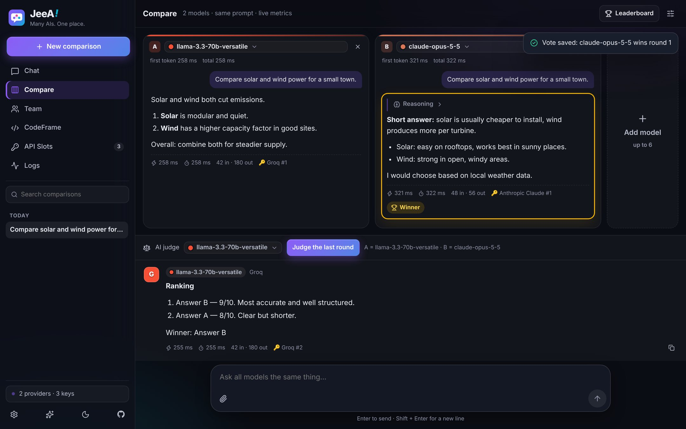
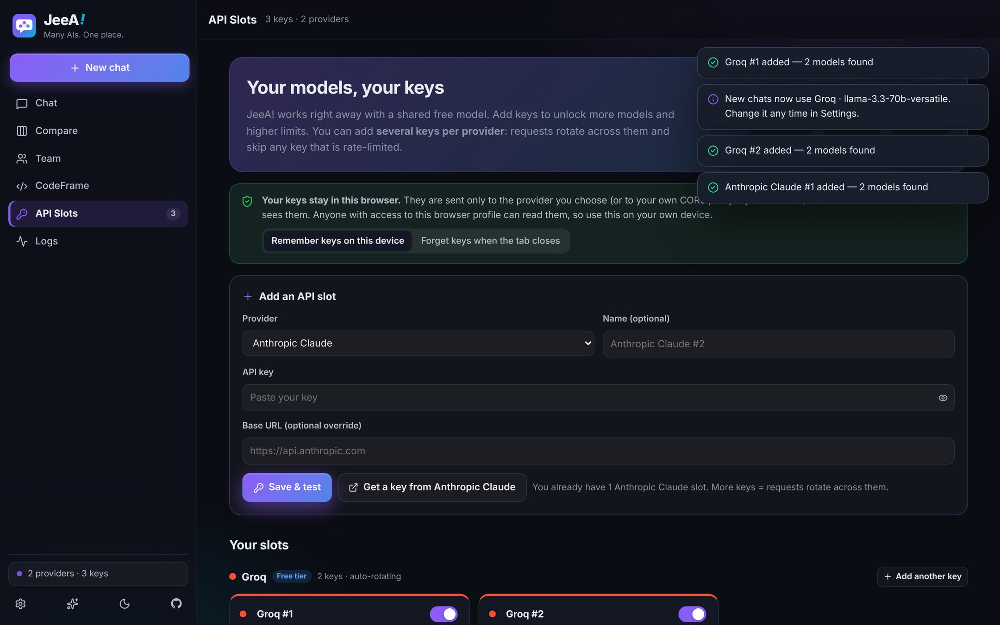
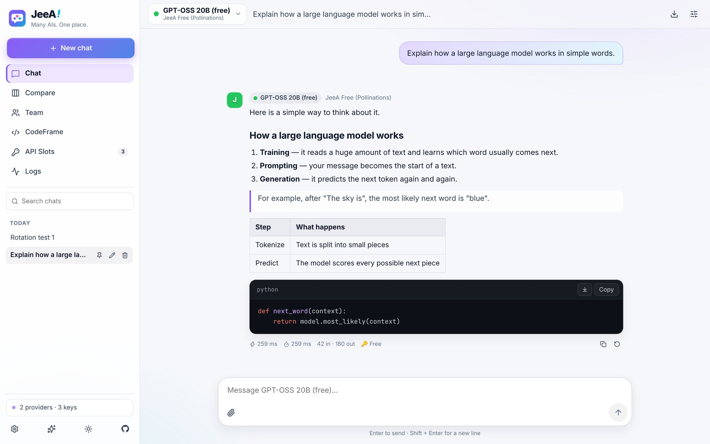

<div align="center">


# JeeA!

**Many AIs. One place.**

Chat with many AI models in one beautiful app. Start free with no key, add your own API keys, compare models side by side, give different models different jobs, and build web apps live.

**Live site:** https://jeewan0406.github.io/Computervision/ *(works after GitHub Pages is switched on, see [Deploy](#deploy-on-github-pages))*


</div>

---

## What you can do

| Feature | What it does |
|---|---|
| 💬 **Chat** | A standard chat: streaming answers, Markdown, tables, code highlighting, the model's reasoning (when it shares it), edit and resend, regenerate, history with search, pin and rename, export to Markdown. |
| 🆓 **Free model** | Works the moment the page opens. No sign-up, no key. It uses the shared free tier of the Pollinations Classic API. |
| 🔑 **API Slots** | Add as many keys as you like for 17 providers, or your own endpoint. Several keys for one provider are rotated, and a key that hits a rate limit is rested while the next one takes over. |
| ⚖️ **Compare** | Send one prompt to up to 6 models at once. See time to first token, total time, speed and tokens. Vote for the best answer, keep a personal leaderboard, or let an AI judge rank the anonymous answers. |
| 👥 **Team** | Give different models different roles in one run. Three ways to work: **Pipeline** (one after another), **Mixture** (all answer, one merges) and **Debate** (argue in rounds, a judge decides). Five ready-made teams. |
| 🧩 **CodeFrame** | Describe an app and watch the code being written, then run it in a locked sandbox. Editor, phone/tablet/desktop sizes, console with "ask the AI to fix these errors", version history, download. |
| 📈 **Logs** | Every request is recorded: provider, model, key name, status, time to first token, total time and tokens. Charts, filters and CSV/JSON export. No keys or message text are stored in the log. |
| 🎨 **Design** | Dark and light themes, 5 accent colours, works on phones, installable as an app (PWA), works offline after the first visit. |

<table>
<tr>
<td></td>
<td></td>
</tr>
<tr>
<td></td>
<td></td>
</tr>
<tr>
<td></td>
<td></td>
</tr>
</table>

## Providers

You can use any model a provider offers: JeeA! loads the live model list from the provider once you add a key, and you can also type any model id by hand.

| Provider | Access | Notes |
|---|---|---|
| JeeA Free (Pollinations Classic) | Free, no key | One text model, one request per IP at a time, at least 45 seconds apart ([Pollinations docs](https://github.com/pollinations/pollinations/blob/master/APIDOCS.md)). Good for trying the app. |
| Google Gemini · Groq · OpenRouter · Mistral · Cerebras · GitHub Models · Hugging Face · Cohere · SambaNova · NVIDIA NIM | Free tier with a key | Free tiers and their limits are set by each provider and change often. Check the provider's page. |
| OpenAI · Anthropic Claude · DeepSeek · xAI Grok · Together AI | Paid key | |
| Ollama · LM Studio | Runs on your computer | Turn on CORS in the local server (see the note in the app). |
| Your own endpoint | Any | Any OpenAI-compatible `/chat/completions` server, or the Anthropic Messages format. |

## Deploy on GitHub Pages

The repository already contains the workflow `.github/workflows/deploy.yml`.

1. Merge this branch into `main`.
2. On GitHub, open **Settings → Pages**. Under **Build and deployment → Source**, choose **GitHub Actions**.
3. Open the **Actions** tab. The workflow "Deploy to GitHub Pages" runs on every push to `main` (you can also run it by hand). It installs, runs the tests, builds and publishes.
4. The site appears at `https://<your-user>.github.io/<repo>/`.

The build uses relative paths, so the same `dist/` folder also works on any other static host or CDN without changes.

## How JeeA! handles very many users

**Short answer:** JeeA! has no server of its own. The page is a set of static files, and each person's browser talks straight to the AI provider with that person's own key. So there is no JeeA! server or database that can be overloaded. The real limits are the static host's bandwidth and each provider's own capacity.

What the design does:

- **Nothing shared to overload.** Chats, keys, settings and logs live in each browser (IndexedDB and localStorage). Adding a million users adds no load to any JeeA! machine, because there is none.
- **Load spreads across keys.** Each person brings their own keys, so provider rate limits apply per person, not to one shared key.
- **Polite retries.** On a server error JeeA! waits and retries with exponential backoff plus random jitter (about 0.6 s, 1.2 s, 2.4 s…). The random part stops thousands of browsers from retrying at the same instant. It also obeys the provider's `Retry-After` header.
- **Key rotation and fallback.** Requests rotate across your keys. A rate-limited key cools down while the next key works. If every key fails before any text arrives, JeeA! tries your fallback models in order.
- **Small and cached.** The first visit downloads about 180 KB (gzip, measured on this build). The code editor and the Claude SDK load only when used. A service worker caches the app, so repeat visits use almost no bandwidth.

What it does **not** do, so you can plan honestly:

- **GitHub Pages has limits.** Pages sites have a *soft* bandwidth limit of 100 GB per month, and GitHub may stop serving a site that goes over, or suggest putting a CDN in front of it. Pages is also not meant for running a commercial SaaS ([GitHub Pages limits](https://docs.github.com/en/pages/getting-started-with-github-pages/github-pages-limits)). At about 180 KB per first visit, 100 GB is roughly 550,000 first visits a month. For more traffic, publish the same `dist/` folder on a CDN host such as Cloudflare Pages or Netlify.
- **The free model is shared and slow by design.** It allows one request per IP at a time, at least 45 seconds apart. It is for trying JeeA!, not for heavy use. Real capacity comes from users' own keys.
- **"Billions at the same time" is a provider question.** No chat app can make the model providers serve more requests than their GPUs allow. JeeA! adds no bottleneck of its own, but it cannot remove theirs.

## Privacy and security

- Keys are stored only in your browser. They are sent only to the provider you choose (or to your own CORS proxy, if you switch it on).
- Choose **"Forget keys when the tab closes"** in API Slots to keep keys only for the current session.
- Model answers are cleaned (sanitized) before they are shown, so a reply cannot inject scripts into the page.
- CodeFrame runs generated apps in a sandboxed iframe **without** `allow-same-origin`. The app cannot read your keys, chats or cookies.
- Anyone who can use your browser profile can read your keys. Use JeeA! on your own device.

## Optional CORS proxy

Some APIs refuse calls made directly from a web page. If **Test** fails with a network error for such a provider:

1. Deploy `proxy/cloudflare-worker.js` as your own Cloudflare Worker (the free plan is enough).
2. In **API Slots → Routing & reliability**, paste the worker URL as the proxy prefix.
3. Tick **"Use CORS proxy"** on that key.

The worker only forwards to a list of known AI hosts, so it is not an open proxy. It does see your key while forwarding, so run your own copy.

## Develop locally

```bash
npm install
npm run dev        # http://localhost:5173
npm test           # unit tests
npm run build      # type-check + production build in dist/
```

Requires Node.js 20.19+ or 22.12+ (CI uses Node 22).

## Project structure

```
src/
  lib/            core logic
    providers.ts    provider catalog (free model + 17 keyed providers)
    llm.ts          streaming clients: OpenAI-compatible + Anthropic SDK
    runner.ts       key rotation, retries, cooldowns, fallback, logging
    team.ts         Pipeline / Mixture / Debate planner and presets
    settings.ts     keys, providers, preferences (localStorage)
    data.ts         conversations (IndexedDB, debounced writes)
    logs.ts         activity log (IndexedDB)
    markdown.ts     safe Markdown + code highlighting
  views/          Chat, Compare, Team, CodeFrame, API Slots, Logs
  components/     model picker, messages, composer, sidebar, dialogs, editor
public/           logo, icons, manifest, service worker
proxy/            optional Cloudflare Worker CORS proxy
tests/            unit tests
```

## Changelog

See [CHANGELOG.md](CHANGELOG.md), or open **What's new** (✨) inside the app.
